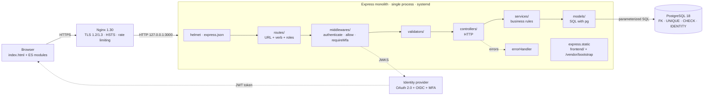

# Proposed architecture, traceability and validation

## Proposed architecture diagram

View (MVC) = `frontend/` · Controller = `routes/` + `controllers/` · Model = `models/` (+ rules in `services/`).

## Traceability table (finding → decision → file → test)

| Finding | Problem | Decision | File(s) | Test (`npm test`) |
| --- | --- | --- | --- | --- |
| H01 | The whole backend in `server.js` | ADR-01 | `routes/`, `controllers/`, `services/`, `models/` | `H01 · the backend is split into MVC layers` |
| H02 | In-memory data, lost on restart | ADR-03 | `database/schema.sql`, `backend/db/pool.js`, `models/` | `H02 · data is stored in PostgreSQL` |
| H03 | Invalid data accepted with 201 | ADR-04 | `validators/` | `H03 · …` (4 tests) |
| H04 | Simultaneous enrollments exceed the seats | ADR-03 | `services/enrollmentService.js` (`FOR UPDATE`) | `H04 · five simultaneous enrollments…` |
| H05 | XSS through `innerHTML` | ADR-06, ADR-07 | `frontend/js/ui.js`, `backend/app.js` (helmet/CSP) | `H05 · …` (2 tests) |
| H06 | No route requires identity or role | ADR-06 | `middlewares/auth.js`, `routes/` | `H06 · …` (7 tests) |
| H07 | No error handler (HTML stack trace, `X-Powered-By`) and no production environment | ADR-04, ADR-05 | `middlewares/errorHandler.js`, `backend/app.js`, `backend/config/config.js` | `H07 · …` (4 tests) |
| H08 | Imprecise HTTP codes, POST without id, unversioned routes | ADR-04 | `errors/AppError.js`, `controllers/`, `routes/index.js` | `H08 · …` (5 tests) |
| H09 | `Math.max(...arr)` fails from 125,156 records and is copied 3 times | ADR-03 | `database/schema.sql` (`IDENTITY`), `validators/common.js` | `H09 · …` (2 tests) |
| H10 | `find` inside `map`: the report blocks the only thread | ADR-03 | `models/reportModel.js` (`JOIN` + `array_agg`) | `H10 · the report is computed in SQL…` |
| H11 | Manual referential integrity | ADR-03 | `database/schema.sql` (FK, UNIQUE, CHECK) | `H11 · …` (3 tests) |
| H12 | Hard-coded startup port | ADR-02 | `backend/config/config.js`, `.env.example` | `H12 · …` (2 tests) |
| H13 | `app.js` mixes HTTP, DOM and events | ADR-01, ADR-07 | `frontend/js/api.js`, `ui.js`, `main.js` | `H13 · the frontend is split…` |
| H14 | There is no search | ADR-04, ADR-07 | `?q=` in `services/` and `models/`, search boxes in `main.js` | `H14 · …` (2 tests) |
| H15 | `main` points to a non-existent `index.js` and there are no tests | ADR-02 | `package.json`, `.nvmrc`, `tests/` | `H15 · package.json pins Node 24…` |

All 37 tests in `npm test` start with the finding ID.

## Before / after validation

| Case | Before (original) | After |
| --- | --- | --- |
| `POST /students {}` | 201 | 422 |
| Semester 99 | 201 | 422 |
| Seats −5 | 201 | 422 |
| Name `` | Executed when the page opens | Displayed as text; the CSP blocks `onerror` |
| Non-existent student | 400 | 404 |
| Duplicate enrollment | 400 | 409 |
| 5 simultaneous enrollments, 1 seat | Several succeed | 1 succeeds, the others 409; seats = 0 |
| Restart the server | Data is lost | Data is kept |
| 130,000 students | `RangeError` from 125,156 | Created with 201; lists of 100 per page |
| Request without token | 200 | 401 |
| Student creates a course | 201 | 403 |
| Staff without MFA modifies data | 201 | 401 |
| Malformed JSON | 400 with HTML page, stack trace and `node_modules` paths | 400 as JSON, no stack trace |
| `X-Powered-By: Express` header | Present | Absent |
| `NODE_ENV=production` without OIDC | (did not exist) | Does not start and states what is missing |
