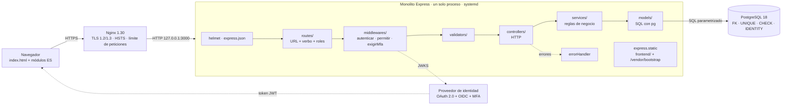

# Arquitectura propuesta, trazabilidad y validación

## Diagrama de la arquitectura propuesta

Vista (MVC) = `frontend/` · Controlador = `routes/` + `controllers/` · Modelo = `models/` (+ reglas en `services/`).

## Tabla de trazabilidad (hallazgo → decisión → archivo → prueba)

| Hallazgo | Problema | Decisión | Archivo(s) | Prueba (`npm test`) |
| --- | --- | --- | --- | --- |
| H01 | Todo el backend en `server.js` | ADR-01 | `routes/`, `controllers/`, `services/`, `models/` | `H01 · el backend está separado en capas MVC` |
| H02 | Datos en memoria, se pierden al reiniciar | ADR-03 | `database/schema.sql`, `backend/db/pool.js`, `models/` | `H02 · los datos se guardan en PostgreSQL` |
| H03 | Datos inválidos aceptados con 201 | ADR-04 | `validators/` | `H03 · POST {} …`, `semestre 99 …`, `cupos −5 …` |
| H04 | Matrículas simultáneas superan los cupos | ADR-03 | `services/matriculaService.js` (`FOR UPDATE`) | `H04 · cinco matrículas simultáneas…` |
| H05 | XSS por `innerHTML` | ADR-06, ADR-07 | `frontend/js/ui.js`, `backend/app.js` (helmet/CSP) | `H05 · un nombre con HTML…`, `H05 · el frontend no inserta HTML…` |
| H06 | Ninguna ruta exige identidad ni rol | ADR-06 | `middlewares/auth.js` (`autenticar`, `permitir`, `exigirMfa`), `routes/` | `H06 · …` (7 pruebas: 401 sin token, 403 por rol, 401 sin MFA) |
| H07 | Sin manejador de errores (traza HTML, `X-Powered-By`) y sin entorno de producción | ADR-04, ADR-05 | `middlewares/errorHandler.js`, `backend/app.js`, `backend/config/config.js` | `H07 · …` (4 pruebas) |
| H08 | Códigos HTTP imprecisos, POST sin id, rutas sin versión | ADR-04 | `errors/AppError.js`, `controllers/`, `routes/index.js` (`/api/v1`) | `H08 · …` (5 pruebas) |
| H09 | `Math.max(...arr)` falla desde 125 156 registros y está copiado 3 veces | ADR-03 | `database/schema.sql` (`IDENTITY`), `validators/comun.js` (límite) | `H09 · …` (2 pruebas) |
| H10 | `find` dentro de `map`: el reporte bloquea el único hilo | ADR-03 | `models/reporteModel.js` (`JOIN` + `array_agg`) | `H10 · el reporte se calcula en SQL…` |
| H11 | Integridad referencial manual | ADR-03 | `database/schema.sql` (FK, UNIQUE, CHECK) | `H11 · …` (3 pruebas) |
| H12 | Puerto de arranque fijo | ADR-02 | `backend/config/config.js`, `.env.example` | `H12 · …` (2 pruebas) |
| H13 | `app.js` mezcla HTTP, DOM y eventos | ADR-01, ADR-07 | `frontend/js/api.js`, `ui.js`, `main.js` | `H13 · el frontend está dividido…` |
| H14 | No existe la búsqueda | ADR-04, ADR-07 | `?q=` en `services/` y `models/`, buscadores en `frontend/js/main.js` | `H14 · …` (2 pruebas) |
| H15 | `main` apunta a `index.js` inexistente y no hay pruebas | ADR-02 | `package.json`, `.nvmrc`, `tests/` | `H15 · package.json fija Node 24…` |

Las 37 pruebas de `npm test` llevan el ID del hallazgo al inicio del nombre.

## Validación antes / después

| Caso | Antes (original) | Después |
| --- | --- | --- |
| `POST /estudiantes {}` | 201 | 422 |
| Semestre 99 | 201 | 422 |
| Cupos −5 | 201 | 422 |
| Nombre `` | Se ejecuta al abrir la página | Se muestra como texto; CSP bloquea `onerror` |
| Estudiante inexistente | 400 | 404 |
| Matrícula duplicada | 400 | 409 |
| 5 matrículas simultáneas, 1 cupo | Pueden entrar varias | Entra 1, las otras 409; cupos = 0 |
| Reiniciar el servidor | Se pierden los datos | Los datos siguen ahí |
| 130 000 estudiantes | `RangeError` desde 125 156 | Se crea con 201; listados de 100 en 100 |
| Petición sin token | 200 | 401 |
| Estudiante crea un curso | 201 | 403 |
| Administrativo sin MFA modifica datos | 201 | 401 |
| JSON mal formado | 400 con página HTML, traza y rutas de `node_modules` | 400 en JSON, sin traza |
| Cabecera `X-Powered-By: Express` | Presente | Ausente |
| `NODE_ENV=production` sin OIDC | (no existía) | No arranca y dice qué falta |

Capturas sugeridas para el informe: Postman con cada caso de la tabla (antes en el repositorio original, después en este), la pantalla con el nombre malicioso como texto, y la salida de `npm test` en verde.
